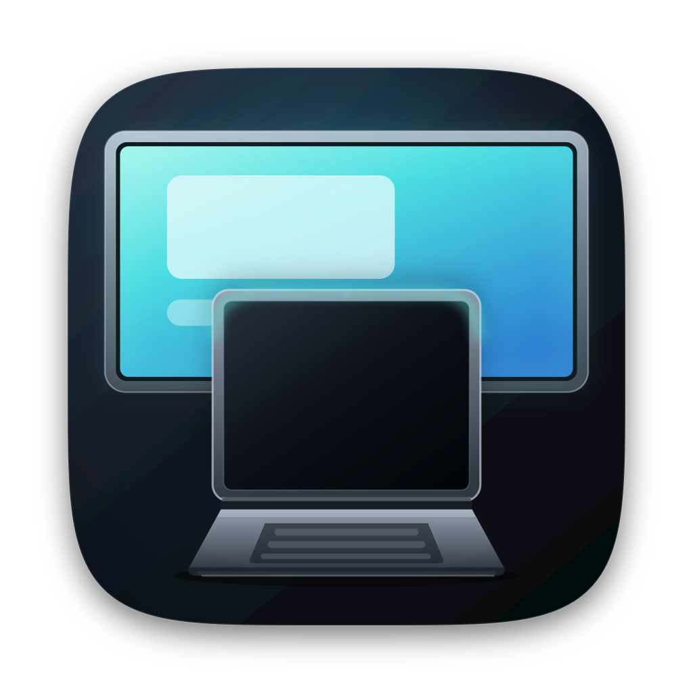

# ClamshellBar

**English** · [中文](README.md)

Turn off the built-in MacBook display for real, the moment an external display starts showing a picture — the same effect as closing the lid, without closing it.



## The problem

macOS only disables the internal panel when the lid is shut. If you want to work on a single large monitor without the laptop screen burning power, generating heat and holding GPU memory, the usual workaround is to drag brightness to zero — the panel is still rendering, windows still wander onto it.

ClamshellBar takes the other path: it disables the panel through `CGSConfigureDisplayEnabled`, so the internal display disappears from the desktop and its backlight goes dark. The behaviour matches clamshell mode; the lid stays open.

## Features

- Menu bar item with manual "turn off / turn on internal display"
- Auto mode: disable when an external display actually outputs a signal, restore when it goes away
- Trigger is *picture*, not *cable*: a projector that is plugged in but unpowered is not mistaken for a usable screen (the menu reports "no signal")
- Guards for unplugging, lid closing, system sleep and display chattering — it will not leave you with a black screen

## Build

macOS 13+ and the Xcode command line tools (`swiftc`).

```bash
./build.sh              # artifacts in build/
./build.sh --install    # also install to /Applications and launch
```

Two artifacts: `ClamshellBar.app` (menu bar app) and `clamshell` (CLI: `status|off|on|doctor`).

## First launch

The app is ad-hoc signed and not notarized, so Gatekeeper blocks the first open when downloaded from a browser:

- right-click → Open, or
- `xattr -dr com.apple.quarantine /Applications/ClamshellBar.app`

## Caveats

**Private API.** Disabling the panel relies on `CGSConfigureDisplayEnabled`, an undocumented symbol Apple may change at any time. Verified on macOS 27.x / Apple Silicon; other models and older systems are untested.

**Only acts with a second display present.** With no external display the app refuses to disable the internal one — otherwise you would face a black screen with no visible way back.

**Auto mode is off by default.** Enable "Auto: turn off on external" in the menu.

**If the screen goes black.** Close and reopen the lid, unplug the external display, or log out — any of these restores the panel. Blind recovery: `open /Applications/ClamshellBar.app` then the first menu item.

## Implementation notes

The undocumented-behaviour lessons this tool accumulated — the internal display vanishing from the online list, hardware mirroring making `enable` silently no-op, commits reporting success while panels sleep, `IOPMAssertionDeclareUserActivity` waking the whole machine — are written up in [NOTES.md](NOTES.md) (Chinese).

## Build status

Pushes to `main` are built by GitHub Actions on a macOS arm64 runner, with the app and CLI uploaded as artifacts; pushing a `v*` tag publishes them to a GitHub Release automatically.

## License

MIT
