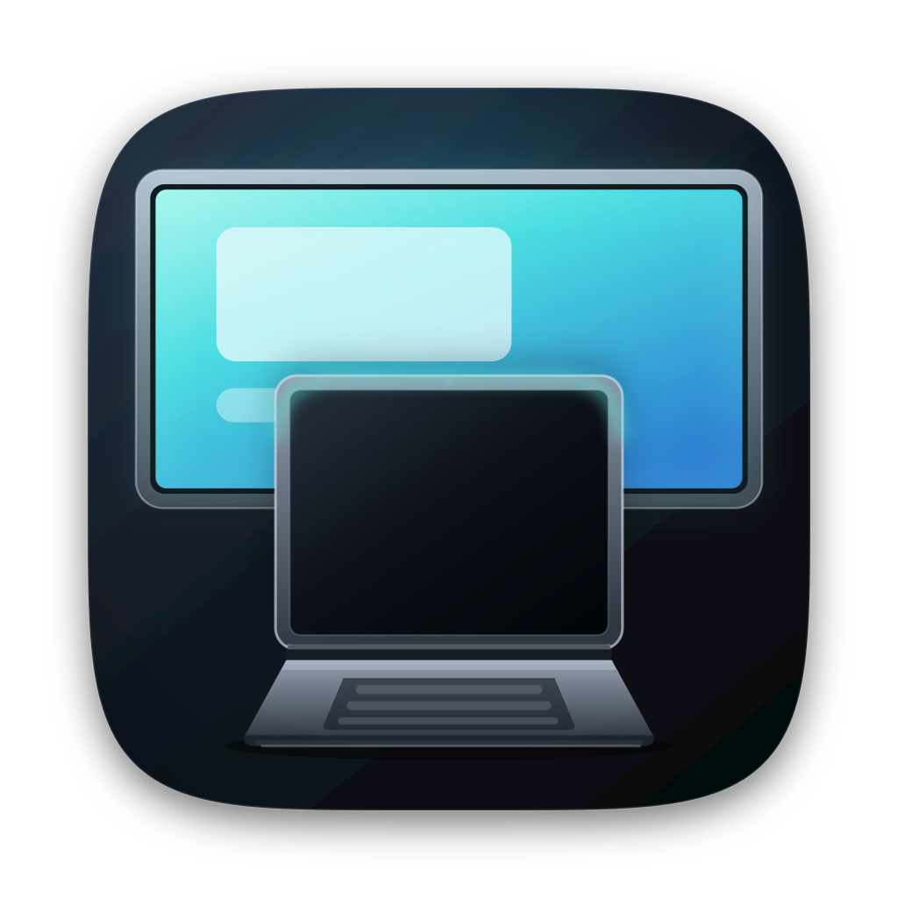

# ClamshellBar

外接屏一有信号，就把 MacBook 自带屏真正关掉——等同合盖（clamshell），但盖子照旧开着。菜单栏里点一下，或者让它自动跟随插拔。



## 它解决的问题

macOS 只在**合上盖子**时才关闭内置屏。想用一块大屏又不想让笔记本屏继续耗电、发热、抢 GPU，通常的替代方案是把亮度调到 0——面板其实仍在渲染，窗口照样跑进去。

ClamshellBar 走的是另一条路：调用 `CGSConfigureDisplayEnabled` 在内核层面禁用这块面板，内置屏从桌面消失、背光熄灭，行为与合盖一致，而盖子可以一直开着。

## 功能

- 菜单栏常驻，一键「关闭内置屏 / 恢复内置屏」
- 自动模式：外接屏**出画**时自动关内置屏，拔线时自动恢复
- 判定「出画」而不是「插了根线」：投影仪只接线不通电时不会被误判，菜单里会显示「外接屏无信号」
- 拔线、合盖、系统睡眠、显示器抖动等边角情况都有对应保护，不会留下全黑

## 构建

需要 macOS 13+ 与 Xcode 命令行工具（`swiftc`）。

```bash
./build.sh              # 产物在 build/
./build.sh --install    # 顺带装到 /Applications 并启动
```

产物两个：`ClamshellBar.app`（菜单栏应用）与 `clamshell`（命令行工具，`status|off|on|doctor`）。

## 首次运行

应用是 ad-hoc 签名的，未做公证。从浏览器下载后首次打开会被 Gatekeeper 拦下：

- 右键 → 打开，或
- `xattr -dr com.apple.quarantine /Applications/ClamshellBar.app`

## 注意事项

**私有 API。** 关闭面板依赖 `CGSConfigureDisplayEnabled`，它不是公开接口，Apple 可能在任意版本中改动其行为。本机在 macOS 27.2 / Apple Silicon 上实测可用；其他机型与旧系统未必。

**只在有外接屏时生效。** 没有第二块屏时，程序拒绝关闭内置屏——否则你将面对一块全黑的屏幕，且没有任何可见的恢复入口。

**自动模式默认关闭。** 菜单里勾选「自动：接外接屏即关」后才会跟随插拔。

**万一黑屏。** 合上再打开盖子、拔掉外接、注销，任意一项都会让面板回来；也可以盲打 `open /Applications/ClamshellBar.app` 后按菜单第一项。

## 实现要点

若干与这套私有接口打交道时踩出来的经验，写在 [NOTES.md](NOTES.md) 里：内置屏关闭后会从在线列表消失、硬件镜像会让 `enable` 静默失效、显示器睡着时 commit 会返回成功却不生效、`IOPMAssertionDeclareUserActivity` 会把整机从睡眠中叫醒等等。

## License

MIT
